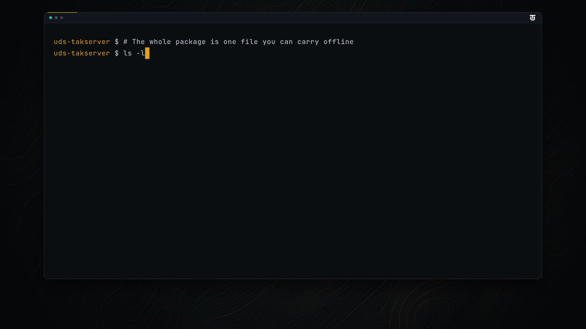
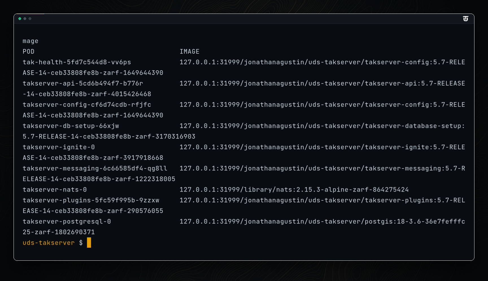
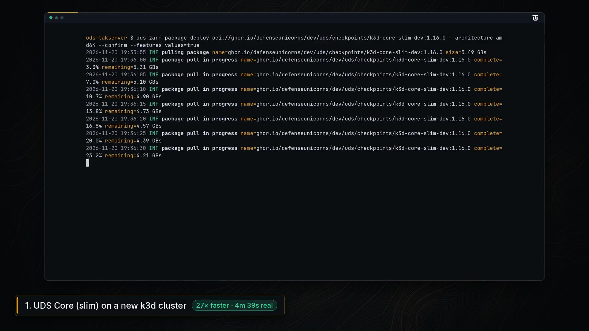
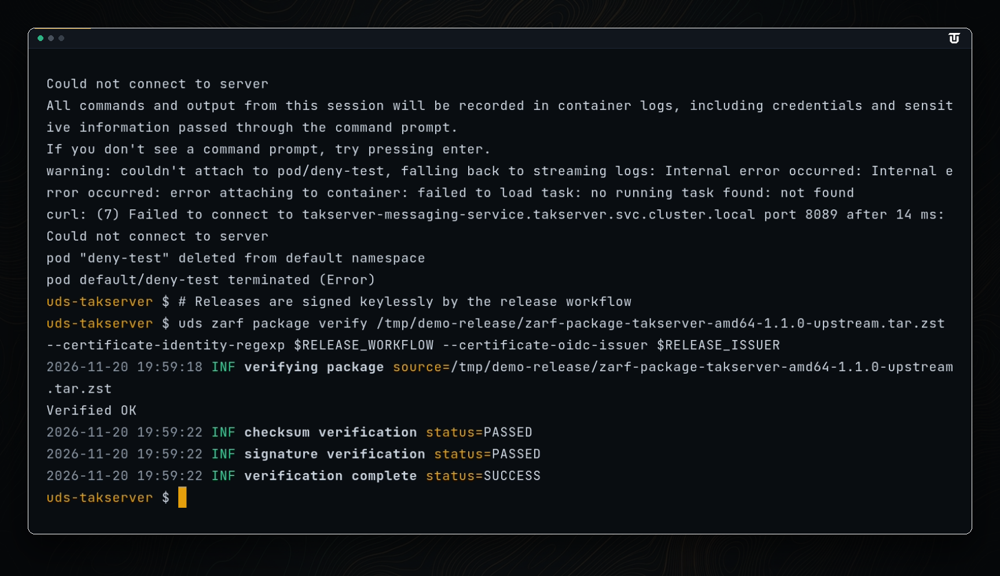
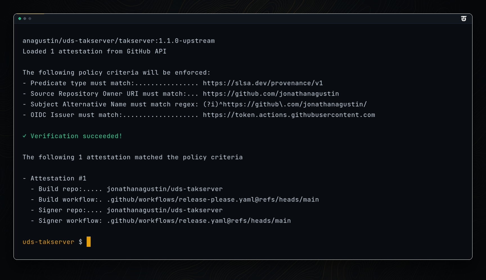
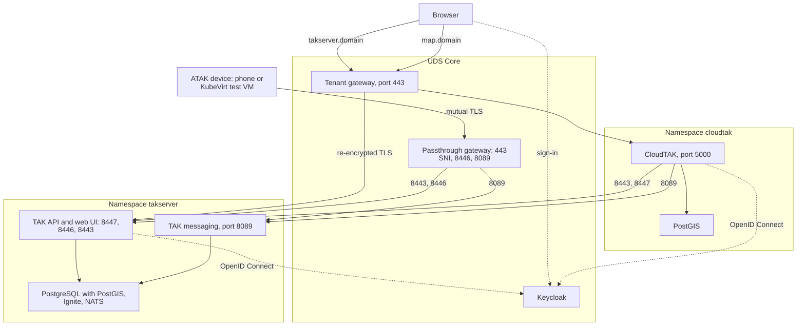
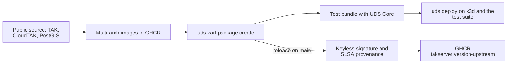

<p align="center">
  <a href="https://github.com/jonathanagustin/uds-takserver/releases/latest"></a>
  <a href="https://github.com/jonathanagustin/uds-takserver/actions/workflows/test.yaml"></a>
  <a href="https://securityscorecards.dev/viewer/?uri=github.com/jonathanagustin/uds-takserver"></a>
  <a href="https://www.bestpractices.dev/projects/15775"></a>
  <a href="https://github.com/jonathanagustin/uds-takserver/blob/main/LICENSE"></a>
</p>

<!-- github-only:start -->
<p align="center">
  <picture>
    <source media="(prefers-color-scheme: dark)" srcset="assets/tak-on-uds-dark.svg">
    
  </picture>
</p>
<!-- github-only:end -->

<p align="center">All-in-one solution for packaging, deploying, and operating TAK Server</p>

<!-- github-only:start -->
<p align="center">
  <a href="https://jonathanagustin.github.io/uds-takserver/">Read the documentation</a> ·
  <a href="https://jonathanagustin.github.io/uds-takserver/#ui-preview">Watch the overview trailer</a>
</p>

https://github.com/user-attachments/assets/0643628a-e255-4ca2-8f91-9e6eb42a719b

<!-- github-only:end -->

TAK Server on the Unified Defense Stack (UDS) brings applications, identity, networking, security, and operations together in one integrated environment. [TAK Server](https://github.com/TAK-Product-Center/Server) provides the services that connect Team Awareness Kit (TAK) clients and exchange data. Deploying it on a shared platform also requires identity integration, client certificates, gateways, network rules, databases, and an upgrade process. Adding [CloudTAK](https://github.com/dfpc-coe/CloudTAK) introduces a browser application and its own database. Those pieces need to work together and stay aligned as the deployment changes.

This package connects TAK Server and CloudTAK to [UDS Core](https://docs.defenseunicorns.com/core/)'s Keycloak sign-in, gateways, and default-deny networking. It supplies deployment charts and configuration, uses TAK's certificate tooling at install time, and includes database backup and recovery workflows. Operators get a defined integration to deploy, test, and maintain alongside their other UDS applications.

Zarf packages the application charts, container images, and deployment configuration into versioned artifacts. This repository builds the TAK, CloudTAK, and PostGIS images for amd64 and arm64, publishes signed release packages with build provenance, and includes automated installation and upgrade checks on k3d. Deploy a published package onto an existing UDS Core cluster, or use the local test environment to develop and validate changes. The operating guides cover certificates, sign-in, network access, backup and restore, resource profiles, and the optional Android ATAK test device.

<details>
<summary>Contents</summary>

- [What's included](#whats-included)
- [Install](#install)
- [Usage](#usage)
- [Demo](#demo)
- [Verify a release](#verify-a-release)
- [Architecture](#architecture)
- [Access](#access)
- [Configuration](#configuration)
- [Supported architectures](docs/reference.md#supported-architectures)
- [Testing](docs/reference.md#testing)
- [Repository layout](docs/reference.md#repository-layout)
- [Documentation](#documentation)
- [Known limitations](docs/reference.md#known-limitations)
- [Security](#security)
- [Contributing](#contributing)
- [Code of conduct](#code-of-conduct)
- [License](#license)

</details>

## What's included

- **Upstream TAK chart.** Zarf pulls the public TAK Server chart when it creates the package. A small config chart in `charts/takserver/` adds the UDS `Package` and the ConfigMaps the upstream chart mounts.
- **Keycloak single sign-on (SSO).** The UDS operator registers the Keycloak client, and TAK's own OpenID Connect client handles browser sign-in. Keycloak groups map to TAK roles and groups. See [docs/sso.md](docs/sso.md).
- **Certificates made at deploy time.** A pre-install Job runs TAK's `generateClusterCerts.sh`. No keys or keystores are in git or in any image.
- **UDS networking.** The browser user interface (UI) goes through the tenant gateway. Traffic for the application programming interface (API), enrollment, and streaming goes through the passthrough gateway, including the standard TAK ports 8446 and 8089. NetworkPolicies are default-deny, with explicit per-workload rules. See [docs/networking.md](docs/networking.md).
- **CloudTAK in the browser.** The optional `cloudtak` component (on by default) runs CloudTAK v13.112.3 at `map.<domain>` with its own PostGIS database. Each Keycloak user gets their own TAK certificate. See [docs/cloudtak.md](docs/cloudtak.md).
- **A real ATAK test device.** `atak/` runs Android Tactical Assault Kit for Civilian Use (ATAK-CIV) 5.5.1.10, built from public source, in an Android virtual machine (VM) under KubeVirt. It connects to TAK over mutual Transport Layer Security (TLS) on 8089 like a field device. It is a separate package for amd64 nodes with Kernel-based Virtual Machine (KVM). See [docs/atak-device.md](docs/atak-device.md).
- **Images built from source.** The six TAK images, CloudTAK, and PostGIS are built here for amd64 and arm64 and published to GHCR. Continuous integration (CI) tags each build by a hash of its inputs, so a pull request always tests its own images. See [docs/building.md](docs/building.md).
- **Signed releases.** Each release package is signed keylessly with Sigstore. Its build provenance (SLSA v1, the Supply-chain Levels for Software Artifacts format) is attested in GHCR and attached to the GitHub release. See [Verify a release](#verify-a-release).
- **Supply-chain checks.** CI runs Grype scans, software bills of materials (SBOMs), CodeQL, dependency review, and OpenSSF Scorecard. Renovate keeps dependencies current. See [CI workflows](docs/ci.md).

## Install

### Dependencies

#### Prerequisites

To deploy a published package onto an existing UDS Core cluster, you need the [UDS command-line interface (CLI)](https://github.com/defenseunicorns/uds-cli) (which includes Zarf) and access to that cluster. For a local test cluster, you also need Docker and [k3d](https://k3d.io/). kubectl is optional: `uds zarf tools kubectl` does the same job.

You need `python3` only to run `uds run test-install`, which runs the checks under `tests/`. The deploy itself does not use it.

The [UDS local demo requirements](https://docs.defenseunicorns.com/core/getting-started/local-demo/basic-requirements/) call for at least 4 processor cores, 10 GiB of memory, and 40 GiB of disk for Docker.

The versions below match what this repository pins and tests with: k3d v5.9.0, UDS CLI v0.42.0 (`mise.toml`), and kubectl v1.37.1 for the k3s v1.37.1 cluster that `k3d-core-slim-dev` creates.

#### Install with curl (Linux and macOS)

Each block downloads one pinned release for your operating system and processor architecture, verifies its published SHA-256 checksum, and installs it to `/usr/local/bin`. Run the first block once in the shell you use for the others:

```bash
OS="$(uname -s)"                                   # Linux or Darwin
os="$(echo "${OS}" | tr '[:upper:]' '[:lower:]')"  # linux or darwin
ARCH="$(uname -m | sed 's/x86_64/amd64/; s/aarch64/arm64/')"
if command -v sha256sum >/dev/null; then sha() { sha256sum -c -; }; else sha() { shasum -a 256 -c -; }; fi
cd "$(mktemp -d)"
```

UDS CLI:

```bash
UDS_VERSION=v0.42.0
f="uds-cli_${UDS_VERSION}_${OS}_${ARCH}"
curl -fsSLO "https://github.com/defenseunicorns/uds-cli/releases/download/${UDS_VERSION}/${f}" &&
  curl -fsSL "https://github.com/defenseunicorns/uds-cli/releases/download/${UDS_VERSION}/checksums.txt" | grep " ${f}\$" | sha &&
  sudo install -m 0755 "${f}" /usr/local/bin/uds
```

k3d:

```bash
K3D_VERSION=v5.9.0
f="k3d-${os}-${ARCH}"
curl -fsSLO "https://github.com/k3d-io/k3d/releases/download/${K3D_VERSION}/${f}" &&
  curl -fsSL "https://github.com/k3d-io/k3d/releases/download/${K3D_VERSION}/checksums.txt" | grep "/${f}\$" | sed 's|_dist/||' | sha &&
  sudo install -m 0755 "${f}" /usr/local/bin/k3d
```

kubectl (optional):

```bash
KUBECTL_VERSION=v1.37.1
curl -fsSLO "https://dl.k8s.io/release/${KUBECTL_VERSION}/bin/${os}/${ARCH}/kubectl" &&
  echo "$(curl -fsSL "https://dl.k8s.io/release/${KUBECTL_VERSION}/bin/${os}/${ARCH}/kubectl.sha256")  kubectl" | sha &&
  sudo install -m 0755 kubectl /usr/local/bin/kubectl
```

Then check them with `uds version`, `k3d version`, and `kubectl version --client`.

#### Other install routes

| Tool | Homebrew (macOS and Linux) | apt / dnf |
| --- | --- | --- |
| UDS CLI | `brew tap defenseunicorns/tap && brew install uds` | No repository. Each [release](https://github.com/defenseunicorns/uds-cli/releases/tag/v0.42.0) has `.deb` and `.rpm` files for `apt install ./<file>.deb` or `dnf install ./<file>.rpm` |
| k3d | `brew install k3d` | None |
| kubectl | `brew install kubernetes-cli` | The official [pkgs.k8s.io repository](https://kubernetes.io/docs/tasks/tools/install-kubectl-linux/#install-using-native-package-management) (`core:/stable:/v1.37`) |
| Docker | [Docker Desktop](https://docs.docker.com/desktop/) | Docker's official repositories for [Ubuntu](https://docs.docker.com/engine/install/ubuntu/), [Debian](https://docs.docker.com/engine/install/debian/), and [Fedora](https://docs.docker.com/engine/install/fedora/) |

Homebrew installs the current release, which can be newer than the pins above. Podman can build the images (`CONTAINER_RUNTIME=podman`), but only Docker is tested.

To work on the repository itself, [mise](https://mise.jdx.dev/) installs every pinned tool except Docker, including the linters and test tools in [`mise.toml`](mise.toml): run `mise install`.

For Linux shell and Python checks, `./dev/run` supplies Bash, GNU tools and
Python dependencies in a development container through Docker or Podman.
The host needs a POSIX shell and a running container engine; see
[development container](docs/development-container.md) for commands and scope.

### Deploy a release

Release packages are published to `oci://ghcr.io/jonathanagustin/uds-takserver/takserver:<version>-upstream`, with one artifact per architecture. Add the package to a UDS bundle alongside UDS Core with the [`keylessVerification`](#verify-a-release) block below, or deploy it directly onto a cluster that already runs UDS Core with the passthrough gateway:

```bash
VERSION=1.4.0 # x-release-please-version
uds zarf package deploy "oci://ghcr.io/jonathanagustin/uds-takserver/takserver:${VERSION}-upstream" --confirm
```

Pass `--architecture amd64` or `--architecture arm64` when the cluster architecture differs from the machine you deploy from.

[](#operate-and-trust)



### Quick start

```bash
git clone --recurse-submodules --shallow-submodules https://github.com/jonathanagustin/uds-takserver
cd uds-takserver

# Create the package, deploy k3d-core-slim-dev, deploy the test bundle,
# create a Keycloak test user, and run the validation suite.
uds run test-install
```

Then open `https://takserver.uds.dev/` for TAK Server and `https://map.uds.dev/` for CloudTAK, and sign in through Keycloak.

Package creation pulls the published images from GHCR and Docker Hub. You do not need to build them first. `build.sh` also checks out the TAK source submodule if you cloned without it.

[](#deploy)

### Upgrade from 0.6

Follow [Upgrade from 0.6 to 0.7](docs/how-to/upgrade-from-0-6.md) for the
preparation, deployment, verification, and rollback procedure.

The first deploy of 0.7 changes the following on an existing install:

- **UDS Core 1.16.0.** The test bundle moved `core-base` from 1.15.2 to 1.16.0. The `takserver-oidc` module is built with Pepr 2.0.7, the version Core 1.16.0 runs. The package does not carry the Pepr controller image. It uses the one UDS Core put in the Zarf registry. Upgrade Core first, or deploy both from one bundle as `bundle/uds-bundle.yaml` does.
- **PostgreSQL 15 to 18.** Each TAK and CloudTAK database moves to PostgreSQL 18 in place when its pod first starts. Snapshot the volumes or take a `pg_dumpall` first. Rollback is that snapshot. See [Upgrading from PostgreSQL 15](docs/data.md#upgrading-from-postgresql-15).
- **Keystore password.** An install with ConfigMap `cert-migration` keeps the old `atakatak` keystore password. Its certificates were made with that password. A new install gets a random password in Secret `takserver-keystore`. See [Certificates](docs/configuration.md#certificates).
- **Private keys leave the ConfigMap.** The certificate Job moves private keys and keystores from `cert-migration` to Secrets `takserver-certs` and `takserver-ca-key`. Enrolled clients still chain to the same certificate authority (CA).
- **Gzipped dumps.** The dump CronJobs now write key `dump.sql.gz`. A Secret from 0.6 with key `dump.sql` still restores. See [Backup](docs/data.md#backup).

The new variables `FILESYSTEM_BACKUP` and `POSTGRES_STORAGE_CLASS` default to off and empty, so they change nothing on an upgrade.

## Usage

### CLI

List the available build, deploy, test, and cleanup tasks:

```bash
uds run --list
```

| Task | What it does |
| --- | --- |
| `uds run test-install` | New k3d cluster, package, test bundle, and the full test suite (same as `uds run default`) |
| `uds run dev` | Create the package and bundle, then deploy onto an existing cluster |
| `uds run test-upgrade` | Install the latest published release, then upgrade to the current branch |
| `uds run test-full-core` | New k3d cluster with the full UDS Core layers and the package, then the full-core checks. The layers are metrics, logging, runtime security, backup, monitoring, and Portal |
| `uds run create-dev-package` | Create the Zarf package without an SBOM |
| `uds run build-image` | Build the six TAK images from the public source (`PUSH_IMAGES=true` pushes them) |
| `uds run publish-package` | Create the package with its SBOM, test it, and publish it |
| `uds run lint:all` | YAML, shell, Zarf, Helm, and license-header checks |
| `uds run cleanup` | Delete the k3d cluster and local package tarballs |

Run `uds run --list` for the rest. `hk check` runs the pre-commit checks in [`hk.pkl`](hk.pkl). Run `hk install` once to use them as a git hook.

After deployment, use the [Access](#access) table to choose a browser or certificate endpoint. See [Configuration](#configuration) for package variables and [Documentation](#documentation) for operating guides.

## Demo

[Watch the overview trailer](https://jonathanagustin.github.io/uds-takserver/#ui-preview): civilian first-responder scenes combined with recorded CloudTAK mapping and sharing on TAK Server.

### Deploy

Build the Zarf package, bundle it with UDS Core, deploy it, sign in through Keycloak, and connect a real ATAK device. 4 min.

https://github.com/user-attachments/assets/7d727d39-b4f1-4251-b440-57c7799c51d1

<details>
<summary>Chapters</summary>

- 0:03 UDS Core (Slim) on a New k3d Cluster
- 0:18 Build the Zarf Package
- 0:33 Bundle the Package with UDS Core
- 0:44 Deploy the Bundle
- 1:03 Package Ready
- 1:22 Sign In through UDS SSO
- 1:50 CloudTAK for Regular Users
- 2:27 A Real ATAK Device on the Same Server

</details>

### Operate and Trust

Air-gapped install, policy at work, CloudTAK and ATAK in sync, security defaults, upgrades, and self-healing. 5 min.

https://github.com/user-attachments/assets/2773b517-9793-45b9-811b-147ce0671d69

<details>
<summary>Chapters</summary>

- 0:03 Air-Gapped Install
- 0:43 Policy at Work
- 1:04 CloudTAK and ATAK in Sync
- 2:30 Secure by Default
- 3:13 Upgrades from the Last Signed Release
- 4:10 Footprint and Self-Healing
- 4:42 What This Does Not Prove

</details>

## Verify a release

Each release package is signed keylessly by `.github/workflows/release.yaml` on `main`, and the signature is recorded in the public Sigstore transparency log. Verify it before deploying, once per architecture:

```bash
VERSION=1.4.0 # x-release-please-version
uds zarf package verify "oci://ghcr.io/jonathanagustin/uds-takserver/takserver:${VERSION}-upstream" \
  --architecture amd64 \
  --certificate-identity-regexp '^https://github\.com/jonathanagustin/(uds-k3d-takserver|uds-takserver)/\.github/workflows/release\.yaml@refs/(tags/v[0-9]+\.[0-9]+\.[0-9]+|heads/main)$' \
  --certificate-oidc-issuer https://token.actions.githubusercontent.com
```

Add the same `keylessVerification` block to the package entry in your bundle (as `core-base` does in [bundle/uds-bundle.yaml](bundle/uds-bundle.yaml)):

```yaml title="uds-bundle.yaml"
  - name: takserver
    repository: ghcr.io/jonathanagustin/uds-takserver/takserver
    ref: <version>-upstream # the VERSION you verified above, followed by -upstream
    keylessVerification:
      certificateIdentityRegexp: "^https://github\\.com/jonathanagustin/(uds-k3d-takserver|uds-takserver)/\\.github/workflows/release\\.yaml@refs/(tags/v[0-9]+\\.[0-9]+\\.[0-9]+|heads/main)$"
      certificateOIDCIssuer: https://token.actions.githubusercontent.com
```

The package index also carries signed SLSA v1 build provenance in GHCR and in the repository's attestations. Verify it with the [GitHub CLI](https://cli.github.com/):

```bash
VERSION=1.4.0 # x-release-please-version
gh attestation verify "oci://ghcr.io/jonathanagustin/uds-takserver/takserver:${VERSION}-upstream" \
  --owner jonathanagustin \
  --signer-workflow jonathanagustin/uds-takserver/.github/workflows/release.yaml
```

Each release attaches the same provenance as a Sigstore bundle (`takserver-<version>-upstream.provenance.sigstore.json`, pass `--bundle <file>`) and as an in-toto JSONL statement (`takserver-<version>-upstream.intoto.jsonl`). To read the verification bundle directly from GHCR, add `--bundle-from-oci`.

The TAK, CloudTAK, and PostGIS container images carry signed SLSA v1 build provenance as well. To verify an image tag listed in `zarf.yaml`:

```bash
gh attestation verify "oci://ghcr.io/jonathanagustin/uds-takserver/<image>:<tag>" --owner jonathanagustin
```

Demo videos on the `demo` release include Cosign bundles (`<video>.sigstore.json`) and SLSA v1 provenance (`demo-videos.intoto.jsonl`):

```bash
cosign verify-blob demo-deploy.mp4 --bundle demo-deploy.mp4.sigstore.json \
  --certificate-identity https://github.com/jonathanagustin/uds-k3d-takserver/.github/workflows/demo.yaml@refs/heads/main \
  --certificate-oidc-issuer https://token.actions.githubusercontent.com
```





## Architecture



The TAK namespace runs in the Istio ambient mesh with default-deny NetworkPolicies, and every flow above has an explicit allow rule from the UDS `Package`. The browser UI is the only TAK path through the tenant gateway. Certificate clients go through the passthrough gateway, so TLS ends at TAK Server and TAK checks the client certificate itself.

Zarf installs the config chart (`charts/takserver/`) before the upstream chart. The config chart creates the `core-config` and `tak-ignite-config` ConfigMaps and the `reg-cred` Secret, and runs the pre-install Job that generates certificates. The `takserver-oidc` Pepr module adds an init container to the config, messaging, API, and plugins pods that writes the OpenID Connect (OIDC) client secret into `CoreConfig.xml` before TAK Server starts.

### Build and release



Release Please opens a release pull request from the Conventional Commit titles. Merging it tags the release, and `release.yaml` creates, signs, verifies, and publishes the package for each architecture, then attests its provenance.

## Access

| Use | Host | Gateway | Service port |
| --- | --- | --- | --- |
| Browser UI (Keycloak sign-in) | `takserver.<domain>` | tenant, 443, re-encrypted to TAK | 8447 |
| CloudTAK map (Keycloak sign-in) | `map.<domain>` | tenant, 443 | 5000 in namespace `cloudtak` |
| Admin UI and API with a client certificate | `takserver-api.<domain>` | passthrough, 443 Server Name Indication (SNI) | 8443 |
| Certificate enrollment | `takserver.<domain>` | passthrough, 443 SNI or 8446 | 8446 |
| Streaming (ATAK, WinTAK) | `takserver-stream.<domain>` | passthrough, 443 SNI or 8089 | 8089 |
| ATAK test device screen (optional) | `atak.<domain>` | tenant, 443 | 8000 in namespace `atak` |

`<domain>` defaults to `uds.dev`. "443 SNI" means the passthrough gateway routes port 443 by the host name the client sends in TLS SNI. Ports 8443 and 8089 require a client certificate. A client can enroll on `<host>:8446` and stream to the same `<host>:8089`, the way ATAK expects. QUIC on User Datagram Protocol (UDP) 8090 is off unless `quic.enabled` is set; when enabled, it uses the same client-certificate check through Envoy Gateway.

**Browser sign-in:** members of the Keycloak group `/UDS Core/Admin` get `ROLE_ADMIN`. Groups under `/TAK/` with a `_READ` or `_WRITE` suffix become TAK groups. For example, `/TAK/Operators_READ` becomes the TAK group `Operators`. Only `/UDS Core/Admin` can sign in to the TAK Server web UI. CloudTAK also lets in `/CloudTAK/Users`, a group for people who use the map but are not admins. See [docs/cloudtak.md](docs/cloudtak.md#who-can-sign-in).

**TAK clients:** the deploy-time Job writes the CA and an admin certificate to the ConfigMap `cert-migration`. Import the CA into the client trust store, then use the admin certificate or enroll a user certificate on 8446 with a bearer token from the browser session. On k3d, host port 443 is the tenant gateway, so passthrough hosts need a port-forward to `passthrough-ingressgateway` or a load balancer in front of it. See [docs/sso.md](docs/sso.md) and [docs/networking.md](docs/networking.md).

## Configuration

| Variable | Default | Purpose |
| --- | --- | --- |
| `DOMAIN` | `uds.dev` | Domain suffix for gateway hosts |
| `TAK_IMAGE_TAG` | `5.7-RELEASE-14` | Tag of the TAK images under `ghcr.io/jonathanagustin/uds-takserver` |
| `IN_CLUSTER_DNS` | `true` | On uds-k3d, add CoreDNS rewrites so `DOMAIN` hosts reach the Istio gateways from inside the cluster |
| `PASSTHROUGH_HOSTS` | `takserver-api takserver-stream` | Hosts under `DOMAIN` that the passthrough gateway serves |
| `PLUGINS_MEMORY_REQUEST` | `320Mi` | Memory request for the TAK plugins container |
| `PLUGINS_MEMORY_LIMIT` | `512Mi` | Memory limit for the TAK plugins container |
| `FILESYSTEM_BACKUP` | `false` | Run a Velero node-agent and back up the database volumes as files. See [docs/data.md](docs/data.md#backup) |
| `POSTGRES_STORAGE_CLASS` | empty (cluster default) | StorageClass for the TAK Postgres volume. Set it only on a new install |
| `CLOUDTAK_STORAGE_CLASS` | empty (cluster default) | StorageClass for the CloudTAK PostGIS volume. Set it only on a new install |

The first six also have package values (`global.domain`, `tak.imageTag`, `dns.inCluster`, `dns.passthroughHosts`, `tak.plugins.memoryRequest`, `tak.plugins.memoryLimit`) that override them at deploy time. `values/common-values.yaml` is the overlay for the upstream chart. `bundle/test-values.yaml` is applied only by the test bundle. Named `small` and `production` overlays are in [docs/profiles.md](docs/profiles.md). See [docs/configuration.md](docs/configuration.md).

## Documentation

| Doc | Covers |
| --- | --- |
| [Package reference](docs/reference.md) | Supported architectures, automated testing, repository layout, and known limitations |
| [Configuration](docs/configuration.md) | Zarf variables, the values overlay, resource sizing, and what the config chart mounts |
| [Single sign-on](docs/sso.md) | Keycloak client, group mapping, and certificate enrollment |
| [Networking](docs/networking.md) | Gateway exposure, standard TAK ports, and the NetworkPolicy allow list |
| [CloudTAK](docs/cloudtak.md) | The browser map client: image, sign-in, TAK connection, rules, and limits |
| [TAKX desktop setup](docs/how-to/connect-takx-desktop.md) | Dedicated client provisioning and a manual compatibility checklist; interoperability is not yet verified |
| [ATAK test device](docs/atak-device.md) | ATAK-CIV in a KubeVirt VM, its certificate, and its test location |
| [Building the images](docs/building.md) | Image builds, platforms, pins, input-keyed tags, and the build cache |
| [Data](docs/data.md) | PostgreSQL, backup and restore, and how to find TAK logs |
| [Values profiles](docs/profiles.md) | The `small` and `production` values overlays and how to apply them |
| [CI workflows](docs/ci.md) | Each GitHub Actions workflow, what starts it, and what it checks |
| [Benchmarks](docs/benchmarks.md) | The load benchmark, its configs, and the record it writes |
| [Policy exemptions](docs/justifications.md) | Every UDS policy exemption, why it exists, and the package requirements not met yet |
| [Decisions](adr/) | Architecture decision records, from certificates at deploy time to the ATAK device |

## Security

> [!NOTE]
> **Status:** pre-1.0 and under active development. See [Known limitations](docs/reference.md#known-limitations).


Report vulnerabilities through a private GitHub security advisory. See [SECURITY.md](SECURITY.md).

## Contributing

Questions and bug reports are welcome in [GitHub issues](https://github.com/jonathanagustin/uds-takserver/issues), and pull requests are accepted. See [CONTRIBUTING.md](CONTRIBUTING.md) for coding standards and the test policy. Pull request titles follow [Conventional Commits](https://www.conventionalcommits.org/), which [Release Please](https://github.com/googleapis/release-please) uses for releases. [Renovate](https://docs.renovatebot.com/) opens dependency updates, with major versions in their own pull requests.

## Code of conduct

Contributors follow the [Contributor Covenant 2.1](CODE_OF_CONDUCT.md). Report conduct violations through the private channel in [SECURITY.md](SECURITY.md).

## License

Copyright © 2026 uds-takserver authors.

[GPL-3.0-only](LICENSE). TAK Server, which the TAK images are built from, is also GPL-3.0. CloudTAK, which the `cloudtak` image is built from, is AGPL-3.0. ATAK-CIV, used only for the test device, is GPL-3.0.
